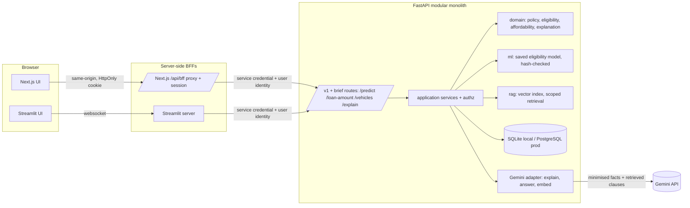
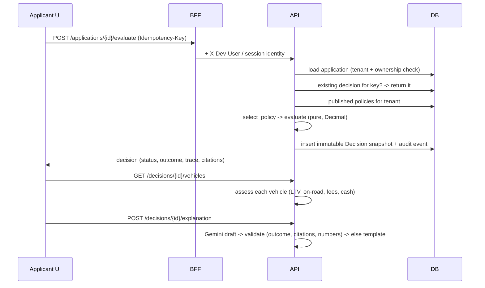
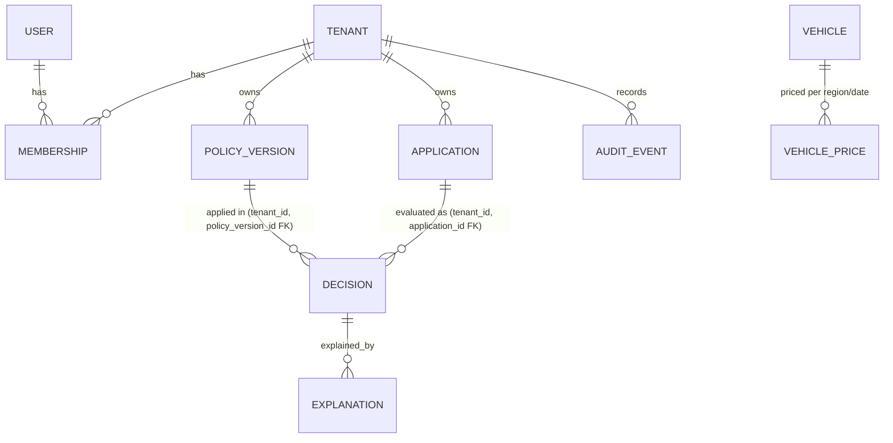
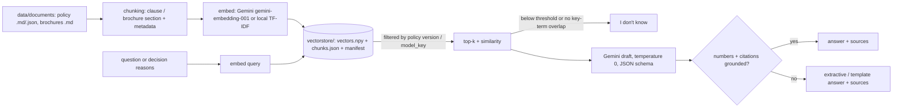

# Architecture, Assumptions and Delivery Plan

## 1. Product understanding

An applicant submits lending-relevant facts. The system works through five steps:

1. Select the lender's **published** policy that is effective on the evaluation date.
2. Evaluate every rule **deterministically**, using Decimal arithmetic and the policy's rounding rules.
3. Record an **immutable snapshot** of the inputs, the policy version and hash, each rule result, the intermediate calculations, and the citations.
4. For approvals, compute the pre-vehicle **borrowing capacity**. Then assess each catalogue vehicle on LTV, on-road cost, fees and the applicant's cash.
5. Explain the recorded result. The AI explains only; it never decides.

The workflow state and the decision outcome are kept separate:

| Workflow (application)                                                                 | Decision status                       | Outcome                                      |
| -------------------------------------------------------------------------------------- | ------------------------------------- | -------------------------------------------- |
| DRAFT, INCOMPLETE, NEEDS_REVIEW, COMPLETED (PROCESSING/FAILED reserved for async jobs) | COMPLETED / INCOMPLETE / NEEDS_REVIEW | APPROVED / REJECTED, set only when COMPLETED |

Missing data, an unsupported score provider, a currency/jurisdiction mismatch, an absent policy, or conflicting policies all produce INCOMPLETE or NEEDS_REVIEW. They **never** produce a rejection.

## 2. Assumptions register

The first working brief was cut off after "requested tenure a", so A1–A13 were assumptions. The official capstone brief arrived later; A14–A16 record the decisions taken to meet it, and the README maps each of its requirements to the implementation.

| ID  | Assumption                                                                                                                                                                                                                                                                                                                                                                       | Status           |
| --- | -------------------------------------------------------------------------------------------------------------------------------------------------------------------------------------------------------------------------------------------------------------------------------------------------------------------------------------------------------------------------------- | ---------------- |
| A1  | Market: India, INR, new private passenger vehicles; one product `new-car-fixed` per tenant                                                                                                                                                                                                                                                                                       | Assumed          |
| A2  | Tenant = **lender**. Dealerships are not modelled yet; they would be a separate tenant kind with offer/availability relationships                                                                                                                                                                                                                                                | Assumed          |
| A3  | Credit score range 300–900; accepted bureaus are defined per policy                                                                                                                                                                                                                                                                                                              | Assumed          |
| A4  | Rates are a fixed nominal annual rate compounded monthly (r = annual/12). Other bases are rejected by the schema                                                                                                                                                                                                                                                                 | Assumed          |
| A5  | Processing fees are paid upfront, not financed (engine v1). Financed fees would mean re-solving the capacity and LTV limits                                                                                                                                                                                                                                                      | Assumed          |
| A6  | On-road price = ex-showroom + registration + insurance + other mandatory charges. If any part is missing, the vehicle is **UNVERIFIED**                                                                                                                                                                                                                                          | Assumed          |
| A7  | Vehicle matching uses the **pre-vehicle borrowing capacity** (min of repayment capacity and product cap), not the requested amount. Per vehicle, the loan is capped by LTV, and affordability requires `contribution + fees ≤ available cash`                                                                                                                                    | Assumed          |
| A8  | Principal is floored to ₹1,000 and the EMI is rounded half-up to ₹0.01 (policy-defined)                                                                                                                                                                                                                                                                                          | Synthetic policy |
| A9  | Applicant inputs are self-declared and unverified. Bureau/income verification integrations are out of scope                                                                                                                                                                                                                                                                      | Assumed          |
| A10 | No age, gender, religion or other unrelated sensitive attributes are collected. Extra fields are rejected (`extra=forbid`)                                                                                                                                                                                                                                                       | Decision         |
| A11 | Policy precedence: same product, effective on date, latest `effective_from` wins; equal start dates = POLICY_CONFLICT (needs review); publish blocks same-date duplicates                                                                                                                                                                                                        | Decision         |
| A12 | Capacity targets in §7 are **assumptions**, not measurements                                                                                                                                                                                                                                                                                                                     | Assumed          |
| A13 | Policies arrive as scanned documents. OCR and extraction run **in-request** by default (user decision 2026-11-09); the BFF waits up to 180 s. `DOCUMENT_PROCESSING=queue` (full stack) runs them as durable background jobs, with the same document states plus `PROCESSING`                                                                                                     | Decision         |
| A14 | The official capstone brief (`Capstone_Req.txt`) requires a model **trained on historical loan data**. The model's approval probability is applied as a policy rule (NW-3.7 / SB-C7): it can decline an application that passes the written rules, never approve one they reject; if it is unavailable the application goes to manual review. See [EVALUATION.md](EVALUATION.md) | Decision         |
| A15 | Both frontends are kept: Streamlit (the brief's suggested UI, applicant journey) and Next.js (dashboard, policy administration, audit). Both are server-side BFFs over the same API                                                                                                                                                                                              | Decision         |
| A16 | Embeddings: Gemini `gemini-embedding-001` when a key is configured; otherwise a deterministic local TF-IDF index, so retrieval works offline and in CI                                                                                                                                                                                                                           | Decision         |

Questions that would materially change the implementation (still open): the real lender policy documents; whether dealerships are tenants; whether financed fees or insurance are in scope; which identity provider the target organisation already uses.

## 3. Architecture

A **modular monolith** (FastAPI) with hexagonal boundaries. The domain does not depend on FastAPI, the ORM, Redis or Gemini. Background workers are added in Phase 4 as separately deployable processes.



**Module map:** identity and authorization (`application/security.py`, `api/deps.py`) · tenants and config (`Tenant`) · applications · policies (versioning, publication) · eligibility engine (`domain/eligibility.py`) · loan maths (`domain/money.py`) · catalogue and affordability (`domain/affordability.py`) · eligibility model (`ml/`) · retrieval (`rag/`) · brief use cases (`application/advisor.py`, `api/brief.py`) · explanations (`domain/explanation.py`, `infrastructure/gemini.py`) · audit (`AuditEvent`).

### Application evaluation sequence



### Policy publication sequence

```mermaid
sequenceDiagram
  participant P as Policy admin
  participant A as API
  participant DB as DB
  P->>A: POST /policies (structured JSON)
  A->>A: schema validation (rules must cite clauses, bands non-overlapping)
  A->>DB: insert DRAFT (canonical JSON + SHA-256) + audit
  P->>A: POST /policies/{id}/publish
  A->>DB: conditional UPDATE status DRAFT->PUBLISHED (blocks same-date conflict) + audit
  Note over A,DB: Published documents are never modified; changes = new version
```

### Entity relationships



Composite, tenant-aware foreign keys (`(tenant_id, application_id)`) stop a decision from referencing another tenant's application, even if application code has a bug. The vehicle catalogue is **shared**. Tenant-specific offers and dealer availability would live in a separate tenant-owned table.

### Deployment (production reference — not deployed)

```mermaid
flowchart TB
  CF[CloudFront + WAF] --> ALB[ALB / ingress, TLS via ACM]
  ALB --> WEB[EKS: web (Next.js BFF) Deployment + HPA]
  WEB --> API[EKS: api Deployment + HPA + PDB]
  API --> RDS[(RDS/Aurora PostgreSQL, Multi-AZ, RLS)]
  API --> REDIS[(ElastiCache Redis: cache - allkeys-lru)]
  WK[EKS: worker Deployment] --> QR[(Separate Redis for BullMQ: noeviction, AOF)]
  API --> QR
  API --> S3[(S3 policy documents, SSE-KMS)]
  API -. egress via NAT .-> GEM[(Gemini API)]
  API --> SM[Secrets Manager / KMS via IRSA]
  COG[Cognito user pool, MFA for admins] --- WEB
```

## 4. Deterministic engine and calculations

- `EMI = P·r·(1+r)^n / ((1+r)^n − 1)`, and `EMI = P/n` when r = 0. All calculations use `Decimal` with 34-digit precision.
- `Available EMI = max(0, qualifying monthly income × max DSR − existing obligations)`.
- `Capacity = floor_to(P(AvailableEMI, r, n), principal_step)`. `Borrowing capacity = min(capacity, product max)`.
- `Eligible = min(requested, borrowing capacity)`. Flags record whether the binding limit was repayment capacity or the product cap.
- Per vehicle: `loan = min(borrowing capacity, floor(on-road × LTV))`, `upfront = on-road − loan + fee`. The vehicle is affordable when `upfront ≤ available cash` and `loan ≥ product minimum`.
- Effective rates (APR including fees) are **not** shown as the contract rate. The UI shows the nominal rate and lists the fee separately.
- Replay re-runs the stored inputs against the stored policy version and compares the SHA-256 of the result. It also checks the policy content hash and the engine version.

## 5. AI usage boundaries

Gemini receives only the outcome, reason codes, calculations, rule results, and the text of the cited clauses. It does not receive identity or free text. The structured output is validated in three ways before use:

1. The outcome must match the recorded outcome.
2. Every citation must be a clause that was evaluated in this decision.
3. Every number in the text must appear in the decision or in the cited clause text.

If validation fails, the model call fails, or no key is configured, the deterministic template is returned and the fallback reason is stored. Policy text is labelled as untrusted evidence in the prompt. The deterministic engine does not read prose at all, so a prompt injection in a policy cannot change a decision (see test `test_6b_ai_claims_are_validated`).

### Scanned policy ingestion (Phase 2)

The workflow runs in-request, a decision recorded in A13.

1. **Upload:** a raw-body `POST /v1/policy-documents` (PDF, PNG or JPEG, up to 10 MB). The type is detected from the file's content and must match the declared `Content-Type`. The original is stored content-addressed (`{tenant}/{sha256}`), and identical re-uploads are deduplicated per tenant.
2. **Transcription (OCR):** Gemini receives the original file and returns the text page by page. The result is checked for pages numbered 1..N in order and for size limits. Nothing is parsed locally, so there is no PDF-parser attack surface. On failure the document is marked `TEXT_FAILED` and can be retried.
3. **Versioned pages and chunks:** each re-transcription increments `text_version`. Chunks are paragraph-aligned and carry the page and section. Retrieval is deterministic keyword search, scoped to tenant and document. It helps reviewers find text; it never decides which rules are evaluated.
4. **Draft extraction:** Gemini maps the pages to the policy JSON schema and must set unstated values to `null` rather than guess. The server overwrites provenance fields. The result is stored as an **untrusted draft**, together with its schema errors and grounding problems.
5. **Human review:** the reviewer compares each draft rule with the original and the transcribed pages, edits it if needed, and confirms. The server re-validates the schema and requires every clause to appear **verbatim on its cited page** (`CLAUSES_NOT_GROUNDED` otherwise). Only then is a `DRAFT` policy version created, and the audit record notes whether the reviewer edited the AI draft.
6. **Publication:** this remains the existing, separately authorised step. Explanations keep using the clauses of the exact policy version recorded in the decision snapshot.

**Limits:** OCR is only as accurate as the model, so the reviewer must check numbers against the original. A clause that spans a page break must be split into one clause per page. Keyword search over uploaded documents serves reviewers; embedding retrieval (below) covers the published policy and brochure corpus.

### Eligibility model (capstone brief 5.1)

- **Training** is offline (`python -m app.ml.train`, notebooks in `notebooks/`). Four models are compared by cost-weighted cross-validation; gradient boosting is selected and its threshold (0.83) minimises expected cost with false approvals costing 5× false rejections ([EVALUATION.md](EVALUATION.md)).
- **Serving:** the API loads `models/eligibility_model.joblib` read-only and refuses it unless its SHA-256 matches `model_card.json`. Scoring returns the probability plus the top factors (change in probability when a feature is replaced by the training median).
- **Decision role:** the engine (v1.1.0) evaluates every written rule first. Only if all pass does it compare the probability with the policy's `credit_risk` rule. A low score gives `REJECTED / CREDIT_RISK_BELOW_THRESHOLD` (cited); a missing model gives `NEEDS_REVIEW`. The probability is recorded in the snapshot, so replay is exact; replay also reports whether the current model artifact is the one that decided.

### Retrieval-augmented generation (capstone brief 5.4, 5.5)



- The index is built offline (`python -m app.rag.ingest`) and shipped with the image; a test fails if the documents change without re-indexing.
- Explanations retrieve only from the decision's exact policy version; the retrieved clause ids become citable and are stored with the explanation (`explanations.sources_json`, migration 0005).
- Vehicle Q&A retrieves only from the selected model's brochure and is audited (`vehicle.question_answered`).

## 6. Security

- **Authentication:** a BFF pattern. In production the identity provider is OIDC (Authorization Code + PKCE, Cognito selected — see ADR-004). The session lives in an HttpOnly, SameSite=Strict cookie. In the local `AUTH_MODE=dev` build, a demo identity cookie is used, and `/v1` accepts it only with the BFF shared secret (`X-Dev-User` + `X-Dev-Secret`). For evaluator convenience in `AUTH_MODE=dev`, the un-prefixed capstone brief endpoints (`/predict`, `/loan-amount`, `/vehicles`, `/explain`) default to demo applicant `u-alice` when no auth headers are sent, and OpenAPI `/docs` exposes an **Authorize** modal for testing other identities. **Dev mode must never be exposed.**
- **CSRF:** non-GET requests through the BFF must come from the same Origin and carry `X-Requested-With: vla`. Combined with SameSite=Strict cookies, this blocks cross-site requests.
- **Authorization:** role permissions are combined with tenant membership and object ownership. A cross-tenant or other-user object returns **404**, not 403, so existence is not leaked. The tenant is derived from membership; `X-Tenant-Id` is honoured only if the user is a member of that tenant.
- **Audit:** every create, evaluate, explain, publish and draft action is recorded with the actor and correlation ID.
- **Errors:** one consistent envelope, `{error:{code,message,correlation_id,details}}`.

## 7. Capacity model (assumptions, not measured)

| Dimension        | Assumed target                                                                          |
| ---------------- | --------------------------------------------------------------------------------------- |
| Registered users | 5 M; 10% monthly active; peak concurrent 20 k                                           |
| Evaluations      | 2 M/month; peak 150/s                                                                   |
| Reads            | 10:1 read/write; vehicle search dominant (cacheable)                                    |
| Data             | ~5 KB snapshot per decision → ~10 GB/month before indexes                               |
| AI               | ≤ 1 explanation per decision, ~1.5 k tokens each; per-tenant budget enforced in Phase 4 |
| SLO              | p95 evaluation < 300 ms excluding AI; availability 99.9%                                |

**Measured so far (local, single process, SQLite; see [LOAD_TEST.md](LOAD_TEST.md)):**

- **Peak throughput:** about 180 req/s, or 48 evaluations/s, with evaluate p95 141 ms at 8 concurrent clients.
- **Saturation:** at 16 clients, throughput falls and write p99 exceeds 1 s, because SQLite allows only one writer at a time.

This does not meet the assumed peak above. The planned remedies are not yet measured:

- PostgreSQL with connection pooling (PgBouncer/RDS Proxy)
- several workers and pods
- monthly partitioning of `decisions` and `audit_events` by `evaluated_at`
- read replicas and caching for search

## 8. SQLite → PostgreSQL (implemented)

SQLite is appropriate for a single-process local demo. It is **not** the shared database for horizontally scaled API pods, because it has a single writer and file locking. What is now implemented:

1. **Migrations:** Alembic (`backend/migrations`). `0001` equals the old `create_all` schema, and existing SQLite databases are stamped there automatically on startup. `0002` adds identities and the outbox, `0003` adds RLS, and `0004` adds the document job marker. A test fails if the migrations and the models ever drift apart.
2. **Row-level security** on every tenant-owned table (PostgreSQL only): `USING/WITH CHECK (tenant_id = current_setting('app.tenant_id', true))`.
   - The API sets the value per transaction (`set_config(..., true)`) from the authenticated membership, so a pooled connection never carries another request's tenant. If it is unset, no rows match.
   - **Roles:** the owner role (`vla_owner`) runs migrations, seed and the outbox relay. The API and the job handlers connect as `vla_app` (`NOBYPASSRLS`).
   - **Append-only grants:** `vla_app` can only insert decisions, explanations, audit events, pages and chunks; it cannot update or delete them.
3. **Same tests on both databases:** the suite runs on SQLite and on PostgreSQL 18, with a fresh database per test owned by `vla_owner` and used as `vla_app`. Direct-SQL tests show that RLS blocks unscoped reads, cross-tenant reads, forged inserts and updates to decisions, even with no application-level filter.
4. **Still open:** money stays as exact decimal strings rather than `NUMERIC(14,2)` (a deliberate, documented trade-off that keeps one schema for both databases), and JSON stays as text rather than `JSONB`.

## 9. Phases, acceptance criteria and status

| Phase                                           | Acceptance criteria                                                                                                            | Status                                                                                                                                                                                                                                                                                                                                                                                                                                                                                                                                                                                                                                                                                                                                                                                                                                      |
| ----------------------------------------------- | ------------------------------------------------------------------------------------------------------------------------------ | ------------------------------------------------------------------------------------------------------------------------------------------------------------------------------------------------------------------------------------------------------------------------------------------------------------------------------------------------------------------------------------------------------------------------------------------------------------------------------------------------------------------------------------------------------------------------------------------------------------------------------------------------------------------------------------------------------------------------------------------------------------------------------------------------------------------------------------------- |
| 1. Local applicant → decision → vehicle journey | 8 E2E scenarios pass. Decimal EMI matches the reference value. Replay is reproducible. UI journey works through the BFF        | **Implemented; verified (2026-11-09).** Docker Compose was run for the first time: the SQLite demo stack came up healthy and the journey through the BFF matched the local result (approve ₹12,00,000, EMI ₹24,764.68)                                                                                                                                                                                                                                                                                                                                                                                                                                                                                                                                                                                                                      |
| 2. Policy ingestion and grounded explanations   | Upload PDF → hash and store → page-preserving extraction → Gemini draft rules → human review → publish. Explanations validated | **Implemented; verified with a stubbed Gemini.** Upload, Gemini OCR, versioned pages and chunks, keyword search, Gemini draft extraction, clause grounding, the review UI and draft creation are done. 61 backend tests pass (10 new), and the frontend type-check and build pass (2026-11-09). **Not yet verified against live Gemini.** Policy Q&A and embedding-based retrieval are not started                                                                                                                                                                                                                                                                                                                                                                                                                                          |
| 3. Tenancy, auth and administration             | OIDC via BFF, MFA for admins, object-level tests, tenant config versions                                                       | **Mostly implemented.** API: validates OIDC access tokens (RS256 signature via JWKS, issuer, `aud` or Cognito `client_id`, expiry, `token_use`, scope) and maps `issuer + sub` to a linked user; tenant access still comes only from memberships. BFF: Authorization Code + PKCE (S256), state and nonce, tokens kept server-side (Redis or memory), HttpOnly `__Host-` session cookie, refresh, revocation and IdP logout. Verified end to end against a standards-based mock IdP (mock-oauth2-server 6.1.4), including state replay, CSRF on logout and fail-closed refresh; 12 token-validation tests. **Not verified against a real Cognito pool. Admin MFA is enforced in the Cognito pool configuration (MFA required), not by the API**, because Cognito access tokens carry no `amr` claim. Tenant config versioning is not started |
| 4. Durable jobs, reliability, observability     | Outbox → BullMQ, idempotent handlers, retries with jitter, DLQ replay, per-tenant fairness, rate limits, OpenTelemetry         | **Implemented; verified on Redis 8.10.** Transactional outbox, a relay to BullMQ (outbox id = `jobId`, `SKIP LOCKED`, backpressure) and a Python BullMQ worker with 4 attempts, exponential backoff and 50% jitter. Handlers are idempotent (a stale or duplicate delivery is skipped), the final attempt records the failure, malformed payloads fail as unrecoverable, and `app.worker.admin` lists and replays failed jobs. The cache Redis (LRU) and queue Redis (noeviction + AOF) are separate. Per-tenant AI budget (fails closed to templates) and upload rate limit (429). Prometheus metrics (API `/metrics`, worker `:9100`) and JSON logs whose correlation ids follow a request into the worker. **Not done:** OpenTelemetry tracing and cross-tenant fair scheduling (one shared queue)                                       |
| 5. PostgreSQL, load tests, AWS artefacts        | Alembic + RLS, CI against Postgres, k6 results, Terraform + Helm, CI/CD with scanning and rollback                             | **Mostly implemented.** Alembic migrations and PostgreSQL RLS (§8); the suite runs on SQLite and PostgreSQL locally and in CI; full Compose stack (`docker-compose.full.yml`: PostgreSQL 18.6, two Redis instances, migrate, API, worker, web) verified locally with the API connected as `vla_app`; load-test script and measured local results ([LOAD_TEST.md](LOAD_TEST.md), SQLite only); backup/restore tool and drill ([RUNBOOK.md](RUNBOOK.md)); CI with service containers, image scanning and smoke tests of both stacks. **Not yet run on GitHub.** Kubernetes, Terraform and continuous deployment deferred by decision (2026-11-09); load test not repeated on PostgreSQL                                                                                                                                                       |

## 10. Defense notes (tradeoffs)

- **Why deterministic plus an LLM, rather than an LLM alone?** Lending decisions must be reproducible, auditable and explainable at clause level. LLM output is probabilistic and can invent thresholds.
- **Why a monolith?** One team and one transactional boundary (decision + snapshot + audit). Extract services only when a module needs independent scaling (for example, ingestion workers) or separate ownership.
- **Why does 404 hide cross-tenant objects?** It avoids enumeration of other tenants' data.
- **What would change these choices?** A real lender's policy may need rule types this schema lacks (for example, income-based LTV tiers). Add them as typed rules with tests, not as free-form expressions. Do not execute code extracted from documents.
